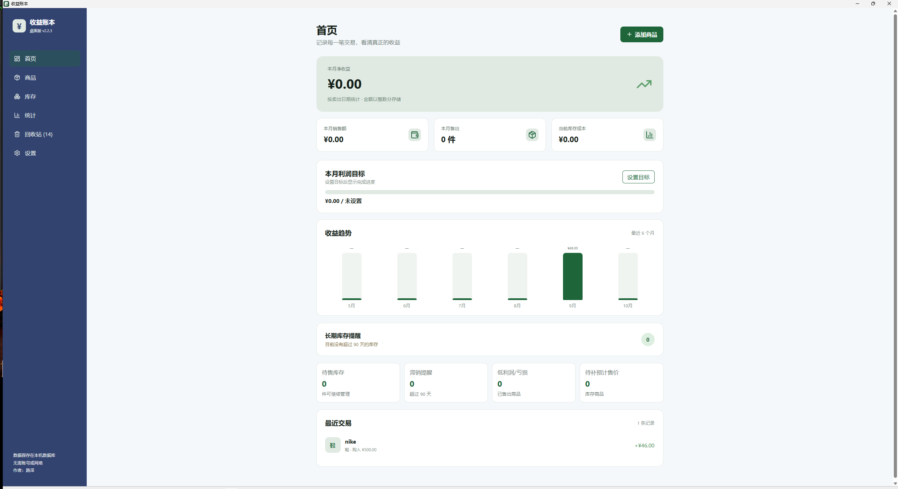
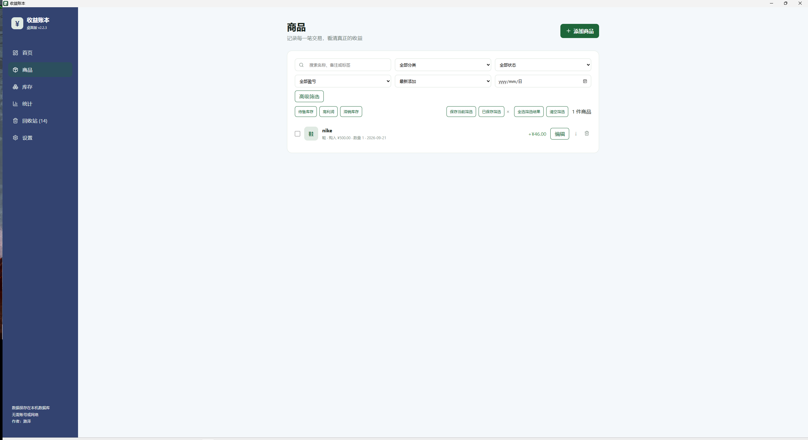
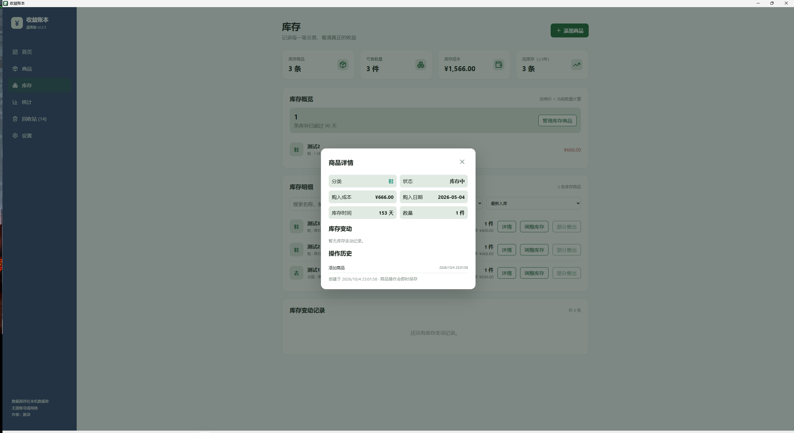
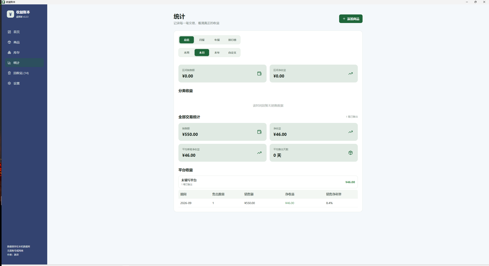

# 收益账本｜桌面版 v2.2.3

一个用于本地记录商品购入、库存、售出和收益的轻量桌面应用，适用于个人搬砖、二手倒卖及少量商品售卖场景。

## 界面预览

### 首页概览

收入趋势、月度目标、库存提醒和近期交易集中展示，快速掌握当前经营情况。



### 商品管理

支持关键词、分类、状态、盈亏、日期等筛选，并提供批量选择与快捷筛选操作。



### 库存详情与追溯

查看库存数量、库存成本、长期库存提醒，并通过商品详情追溯库存信息和操作历史。



### 统计报表

按时间维度汇总销售额、净收益、利润率和平台收益，辅助复盘交易表现。



## 项目状态

当前版本：桌面版 v2.2.3

v2.2.3 左上角版本号改为读取实际安装包版本，并增加发布版本一致性校验、MIT 许可证、Windows 安装包元数据与 GitHub 自动测试/发布流程。

v2.2.1 修复全量与部分售出在空值或非法成交价、费用下可能保存为 ¥0 的校验回退；所有提交操作都会从原始表单重新计算金额。补齐完整备份图片恢复的前端测试。

v2.2.0 新增独立库存页面、库存数量与变动流水、补货入库、盘点调整和部分售出；统一全量/部分售出的“单件成交价 × 数量”口径；完整 JSON 备份升级为 v2，包含库存流水并精确恢复图片状态。新增分页、筛选偏好、图片压缩与库存排序。

历史版本（v2.1.x 至 v2.0.x）依次完善了界面主题与分类色标、筛选与批量操作、图片凭证、导入导出、回收站、SQLite 迁移、数据校验和桌面体验。

运行 `npm test` 验证前端业务逻辑，运行 `npx tsc --noEmit` 检查类型；
在 src-tauri 目录运行 `cargo test` 验证数据库迁移与导入事务回滚。

项目目前仅支持本地运行，不包含云端同步和账号系统。

## 环境要求

- Node.js 20 或更高版本
- npm
- Rust MSVC 工具链
- Microsoft C++ Build Tools（Windows）

## 当前功能

- 新增、编辑、删除商品
- 商品库存管理、库存天数、库存成本与低库存提示
- 补货入库、盘点调整、全量售出与部分售出
- 库存变动流水，可从商品详情追溯
- 自动计算净收益和利润率
- 本周 / 本月 / 本年 / 自定义日期统计
- 搜索、分类、状态、日期、盈亏筛选
- 商品页与回收站分页；可在设置中选择每页 10 / 20 / 50 条
- 保存筛选条件，并可设置滞销提醒天数与低利润阈值
- 最近 6 个月收益趋势图
- 分类收益统计
- 90 天长期库存提醒
- JSON v2 完整备份与恢复（商品、图片、回收站、分类、费用模板和库存流水）
- 使用系统“另存为”对话框导出 JSON 和 CSV
- 批量导入 CSV，自动跳过重复记录
- 导入前预览新增、重复、错误和覆盖数量，确认后才写入
- 一键打开 SQLite 数据目录
- 正式桌面应用和安装程序图标
- SQLite 本机数据库，无需 Supabase
- 新数据库首次启动为空，不迁移旧版 LocalStorage 数据

## 数据说明

桌面版数据保存在应用数据目录的 `income-ledger.db` SQLite 数据库中，建议定期在“设置”页面导出 JSON 备份。

每位使用者的数据只保存在自己的电脑中，不会上传到 GitHub，也不会与其他使用者自动同步。浏览器预览模式仍使用 LocalStorage。

### 备份与恢复

- **完整 JSON 备份**包含商品、商品图片、回收站、分类、销售平台费用模板和库存变动流水。
- 恢复完整备份会更新备份中同 ID 的商品，并替换分类、费用模板和库存流水；回收站中不在备份内的不同 ID 记录会保留。恢复前请先导出一份当前备份。
- 导入旧版 v1 备份时，由于其中不包含库存流水，当前库存变动记录会被清除。
- CSV 和 Excel 用于商品明细的导入导出；JSON 用于完整备份与恢复。

### 删除规则

- 商品的普通删除会移入回收站，可在回收站恢复。
- 永久删除始终要求确认。
- 可在“设置”中关闭或重新开启“移入回收站”的确认提示。

## 当前限制

- 当前为本地桌面版，不包含账号系统和云端同步。
- 换电脑后不会自动显示原有数据，需要手动导入 JSON 备份。

## 使用方法

### 安装桌面版（推荐）

在 [Releases 页面](https://github.com/luze258/income-ledger/releases) 下载 Windows 安装包 `收益账本_x.x.x_x64-setup.exe` 后双击运行，按安装向导完成安装即可。

升级时安装新版安装包即可，通常会保留本机数据库；但升级前仍建议在“设置”页面导出完整 JSON 备份。安装包当前未进行代码签名，Windows 如显示 SmartScreen 提示，请确认安装包来自本项目的 Releases 页面后，选择“更多信息”→“仍要运行”。

### 从源代码运行

使用前请先安装 [Node.js](https://nodejs.org/)，其中包含 npm。

获取源代码：

- 下载发布的源代码压缩包，解压后进入项目文件夹；或
- 使用仓库地址执行 `git clone https://github.com/luze258/income-ledger.git`。

在项目目录打开终端，安装项目依赖：

可以使用以下任意一种终端：

- PowerShell：Windows 自带，适合大多数用户。
- 命令提示符（CMD）：Windows 自带，命令简单稳定。
- Windows Terminal：可以运行 PowerShell、CMD 和 Git Bash。
- Git Bash：安装 Git 后提供，适合学习 Git 和 GitHub。
- VS Code 集成终端：在 VS Code 中按 `Ctrl + \`` 打开。

无论使用哪一种终端，都需要先进入项目目录。Windows PowerShell、CMD 和 Windows Terminal 可以使用：

```powershell
cd "C:\Users\你的用户名\Documents\income-ledger"
```

Git Bash 可以使用：

```bash
cd "/c/Users/你的用户名/Documents/income-ledger"
```

```powershell
npm ci
```

启动桌面开发版：

```powershell
npm run tauri dev
```

开发服务器运行期间，请不要关闭终端窗口。停止服务器可以按 `Ctrl + C`。

## 收益公式

```text
卖出总额 = 单件成交价 × 售出数量
净收益 = 卖出总额 - 单件购入成本 × 售出数量 - 邮费 - 平台手续费 - 其他费用
利润率 = 净收益 ÷（单件购入成本 × 售出数量）× 100%
```

全量售出和部分售出都以“**单件成交价 × 售出数量**”计算卖出总额。部分售出还支持以下费用方式：

- 邮费、其他费用：按单或按件；按件时会乘以本次售出数量。
- 平台手续费：固定金额，或按销售额比例（百分比）计算。

## 常用命令

```powershell
npm run dev       # 启动开发服务器
npm run tauri dev # 启动桌面开发版
npm run tauri build # 生成 Windows 安装包
npm run format    # 格式化代码
npm run build     # 构建生产版本
npm test          # 运行前端自动测试
npx tsc --noEmit  # 检查 TypeScript 类型
npm run check:versions # 校验发布版本一致性
```

验证桌面端数据库逻辑：

```powershell
cd src-tauri
cargo test
```

Windows 安装包默认生成在：

```text
src-tauri/target/release/bundle/nsis/
```

## 项目结构

```text
src/
├─ main.tsx       # React 启动入口
├─ App.tsx        # 页面、弹窗和界面状态编排
├─ domain.ts      # 金额、统计和导入预览等业务规则
├─ importExport.ts # JSON、CSV、Excel 导入导出
├─ actions.tsx    # 异步操作锁
├─ storage.ts     # SQLite / LocalStorage 数据访问层
├─ types.ts       # 数据类型
├─ *.test.ts      # 业务、导入导出、操作锁与本地存储测试
├─ styles.css     # 主样式
├─ overrides.css  # 覆盖样式
├─ chart.css      # 图表样式
└─ vite-env.d.ts  # Vite 类型声明
src-tauri/        # Tauri、Rust 命令、SQLite 迁移和桌面打包配置
```

## 常见问题

### 提示找不到 node 或 npm

请确认已经安装 Node.js，并重新打开终端。可以使用以下命令检查：

```powershell
node -v
npm -v
```

### 网页打不开

请确认开发服务器仍在运行，并访问终端显示的地址。启动命令为：

```powershell
npm run dev
```

### 修改代码后页面没有更新

请先保存文件，再刷新网页；必要时使用 `Ctrl + Shift + R` 强制刷新。
