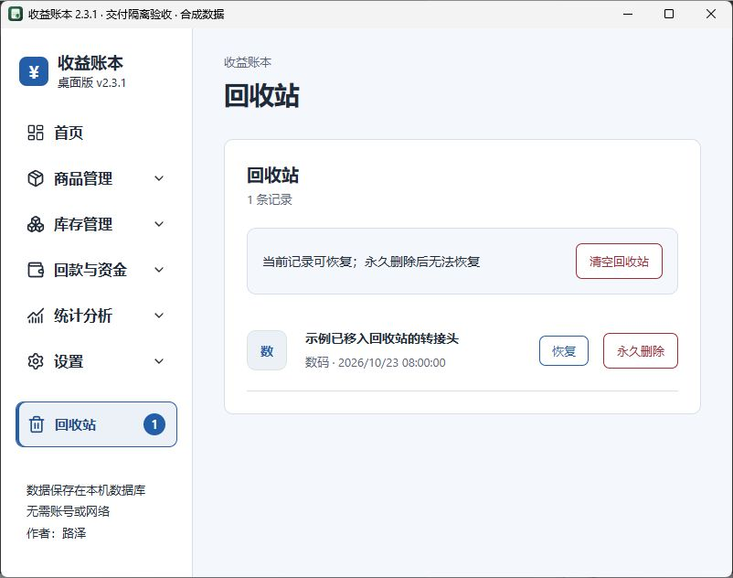

# 收益账本｜桌面版 v2.3.1

用于个人商品购入、库存、售出、回款和售后记录的本地桌面应用。基于 React、TypeScript、Vite、Tauri 2 和 SQLite，无需账号，不包含云端同步。

源码版本为 **2.3.1**；可下载的 Windows 安装包以 [GitHub Releases](https://github.com/luze258/income-ledger/releases) 实际发布内容为准。完整变更见 [CHANGELOG](CHANGELOG.md)，验证范围见 [验收说明](docs/VALIDATION.md)。

## 界面预览

蓝白主题的原生桌面截图，使用合成示例数据，不包含个人账本。

### 经营总览

区分售出净收益、已确认回款净收益和营运占用，集中展示回款提醒与最近商品。


### 分组导航与回收站

一级导航使用图标与较大字号，二级页面缩进显示；回收站有独立入口、数量徽标和选中状态。



## 功能与页面

| 栏目       | 页面与功能                                                 |
| ---------- | ---------------------------------------------------------- |
| 首页       | 经营总览、资金状态、待办提醒、最近商品、收益趋势           |
| 商品管理   | 商品列表、分类与费用模板；搜索、筛选、批量选择、图片与详情 |
| 库存管理   | 当前库存、补货、盘点、部分售出、库存变动流水               |
| 回款与资金 | 资金概览、回款管理、结算差额核对、售后记录                 |
| 统计分析   | 收益概览、月度报表、年度报表、排行榜                       |
| 设置       | 外观与使用偏好、JSON 完整备份、CSV / Excel 明细导入导出    |
| 回收站     | 恢复记录、确认后永久删除                                   |

商品页支持分类、状态、日期、盈亏及库存天数等筛选，可保存筛选条件。商品页和回收站支持分页，每页可选择 10、20 或 50 条。

## 回款与资金口径

- **已售出不等于已回款**：售出收益按卖出日期统计，回款收益按到账日期及售后调整日期统计。
- 新业务待回款与历史回款待确认分列。旧版已售记录不会自动补填到账日期或金额，也不作为新业务待回款本金计入营运占用。
- 回款可按数量分次登记；部分到账会拆分记录，并按整数分分摊金额与费用。
- 预计结算额与实际到账额不一致且原因未填写时，保留为差额待核对，其收益暂不计入已确认回款收益与月目标。
- 营运占用按库存成本与新业务待回款本金汇总。现金余额需要人工填写并核对，应用不会据此推算完整的可用资金。
- 售后记录独立保存，支持部分退款、退货及库存报损。退货商品确认实际收回后才恢复库存；平台已从到账额扣除的退款不会重复扣减。

售出收益的基本计算：

```text
卖出总额 = 单件成交价 × 售出数量
售出净收益 = 卖出总额 - 单件购入成本 × 售出数量 - 邮费 - 平台手续费 - 其他费用
成本利润率 = 售出净收益 ÷ 购入成本 × 100%
```

全量和部分售出使用相同成交口径。部分售出支持按单 / 按件计算邮费及其他费用，平台手续费支持固定金额 / 百分比。

## 安装与升级

Windows x64 桌面版需要 WebView2 运行时。在 [Releases 页面](https://github.com/luze258/income-ledger/releases) 下载 `income-ledger_<版本>_x64-setup.exe`，按安装向导操作。请核对下载来源与版本；源码更新不代表同版本安装包已经发布。

使用同一正式应用标识升级会继续使用原有数据目录。建议升级前在「设置 → 数据备份与导入」导出完整 JSON 备份，升级后核对原有记录。应用不会自动读取浏览器预览版的 LocalStorage。

### 升级后为什么没有变成蓝白色？

升级会保留已有主题、强调色和侧栏颜色。要应用本次预览中的配色，打开：

**设置 → 外观与使用偏好 → 蓝白**

点击「蓝白」会同时设置蓝白主题、蓝色强调色和白色侧栏；之后仍可自定义。三个外观设置都不存在的新环境才默认使用蓝白配色。

## 数据、备份与恢复

桌面账本保存在应用数据目录的 `income-ledger.db` 中，可从「设置 → 数据备份与导入 → 打开数据目录」定位。每位使用者的数据只保存在自己的电脑，不会随源码上传至 GitHub。

浏览器预览使用 LocalStorage，与桌面 SQLite 相互独立；清理浏览器站点数据会影响该浏览器中的预览账本。若浏览器数据读取失败或结构损坏，应用会显示错误并停止本次会话写入，避免把读取失败当成空账本覆盖。

### 完整 JSON 备份

当前导出格式为 **v4**，可导入 v1、v2、v3、v4。完整备份包含：

- 全部商品及图片状态，包含回收站；
- 分类、平台费用模板、库存变动流水；
- 回款状态、结算核对信息、资金配置及售后记录。

**恢复完整备份会用备份内容替换当前全部商品（含回收站）、分类、费用模板、库存流水及资金 / 售后配置。** 不在备份中的当前记录不会作为额外记录保留。导入先显示预览，确认后才写入；请在恢复前核对文件与覆盖范围。

旧版 v1 不含库存流水，恢复后库存流水为空；v1 / v2 不含资金与售后配置，恢复时使用默认资金配置和空售后列表。旧售出记录缺少回款信息时保留为历史待确认。

没有完整备份标识的普通 JSON 商品数组使用商品导入规则，不等同于完整备份恢复。

### CSV 与 Excel

CSV / Excel 用于有效商品明细的导入导出，不包含完整图片、回收站、资金及售后集合，不能代替完整 JSON 备份。桌面导出使用 Windows 原生「另存为」对话框；浏览器预览使用下载文件。

CSV / Excel 导入采用合并模式，先预览新增、重复及错误记录，确认后写入。普通删除会移入回收站；永久删除始终需要确认。

## 从源代码运行

需要 Node.js **20.19+ 或 22.12+**、npm；桌面开发另需 Rust MSVC 工具链、Microsoft C++ Build Tools 和 WebView2。

```powershell
git clone https://github.com/luze258/income-ledger.git
cd income-ledger
npm ci
npm run tauri dev
```

仅预览前端可运行 `npm run dev`，访问终端显示的地址。开发进程运行期间需保持终端打开，按 `Ctrl + C` 停止。

### 检查与构建

```powershell
npm run check:versions
npm test
npx tsc --noEmit
npm run build
cargo test --manifest-path src-tauri/Cargo.toml --lib
npm run tauri build -- --bundles nsis
```

`npm run format` 格式化前端代码。Windows 安装包默认输出至 `src-tauri/target/release/bundle/nsis/`。

`check:versions` 检查 package.json、package-lock.json 两处版本、Cargo.toml 及 Tauri 的版本来源。CI 在 main 推送和 PR 时运行检查；Release 工作流仅由 `v*` 标签触发，且标签必须与应用版本一致。

### 独立桌面测试配置

仓库提供 `src-tauri/tauri.acceptance.conf.json`，使用独立应用标识、程序名和数据目录，不读取正式账本：

```powershell
npm run tauri dev -- --config src-tauri/tauri.acceptance.conf.json
```

该测试配置和浏览器预览都不会自动复制正式账本。测试数据需要自行录入或导入。

## 项目结构

```text
src/
├─ App.tsx              # 应用状态与页面编排
├─ components/          # 侧栏、商品列表、回款面板、弹窗等共享组件
├─ pages/               # 首页、库存、报表、设置与回收站页面
├─ navigation.ts        # 导航分组与旧页面名称兼容
├─ domain.ts            # 金额、库存、统计与导入预览规则
├─ finance.ts           # 回款、结算核对、营运占用与售后规则
├─ importExport.ts      # JSON / CSV / Excel 解析及导出
├─ exportFile.ts        # 原生保存对话框与浏览器下载
├─ storage.ts           # SQLite / LocalStorage 数据访问
├─ actions.tsx          # 异步操作锁
├─ feedback.tsx         # 提示与确认对话框
├─ app.css              # 当前 UI 样式
└─ *.test.ts(x)         # 业务与存储测试
src-tauri/              # Rust 命令、SQLite 迁移、权限与打包配置
docs/VALIDATION.md      # 验证范围与限制
CHANGELOG.md            # 版本更新记录
```

## 当前边界

- 面向本地个人商品管理，不含账号、云同步或多人协作。
- 换电脑需要手动恢复完整 JSON 备份，浏览器与桌面数据不会自动互通。
- 首次运行的新桌面数据库为空，不会自动导入示例账本。
- 提交到仓库的截图仅使用合成数据。数据库、构建输出、安装包和本机验收资料不随源码提交。

## 许可证

[MIT](LICENSE)。
